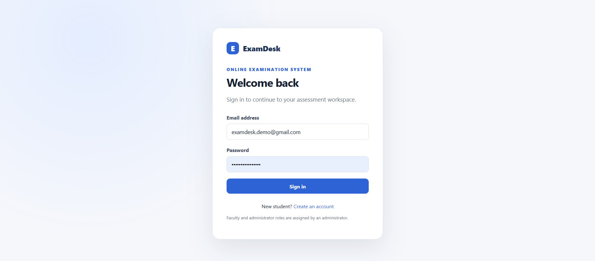
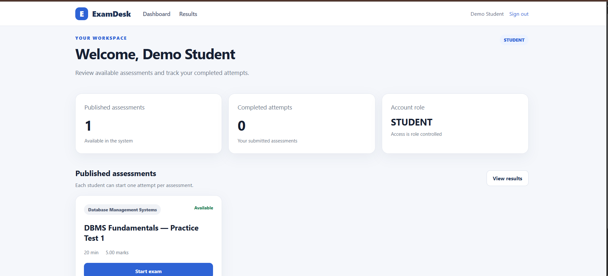
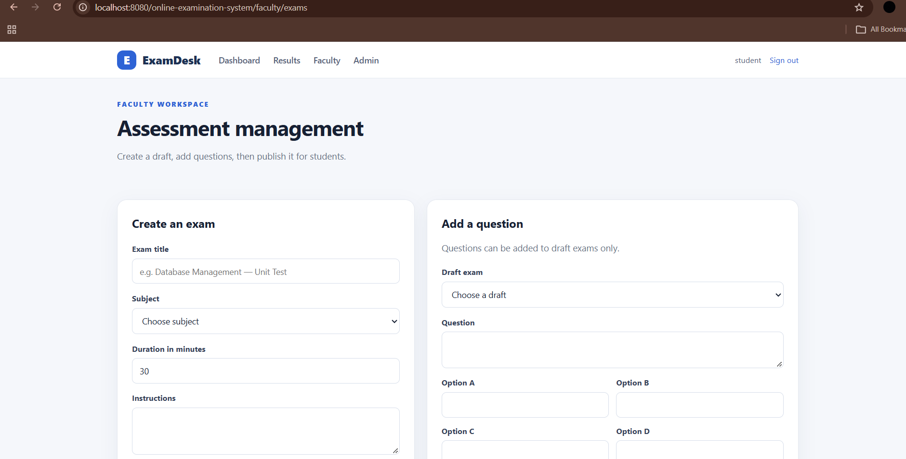
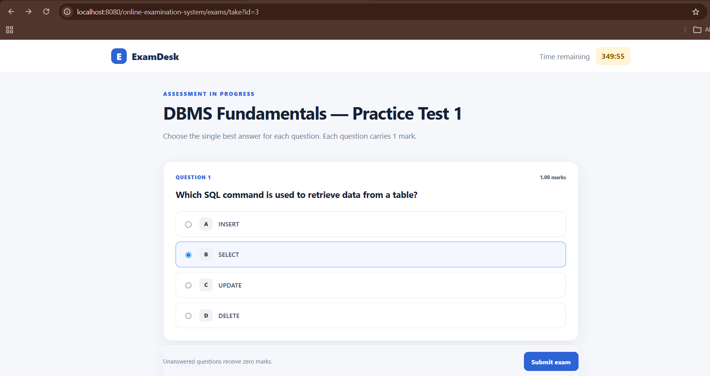
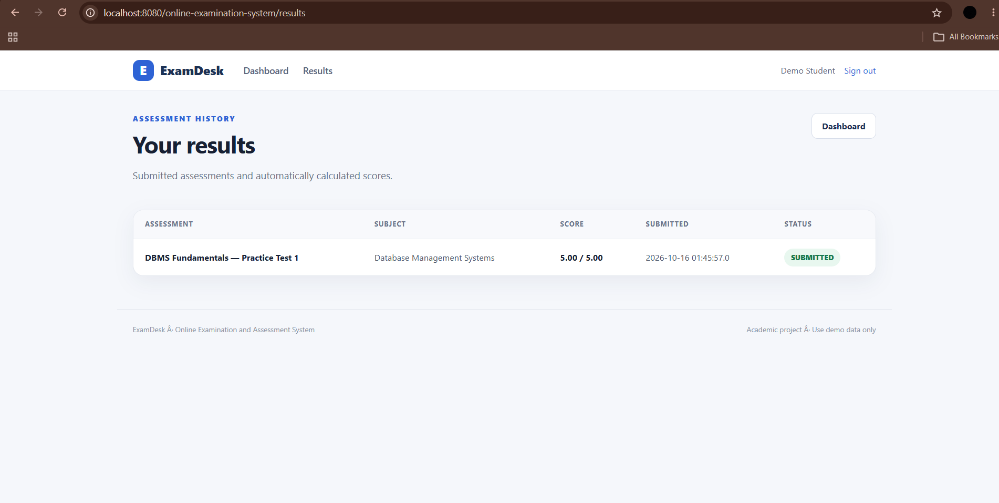

# ExamDesk — Online Examination and Assessment System

ExamDesk is a Java web application for multiple-choice assessments in a college setting. It is scoped as a BSc Computer Science final-semester project and demonstrates server-side programming, relational database design, authentication, role-based workflows, timed assessments, automatic scoring, and unit testing.

## Implemented workflows

- **Student:** register, sign in, view published assessments, start one attempt per exam, complete a timed multiple-choice assessment, submit answers, and view results.
- **Faculty:** create draft exams, add questions and answer options, set marks and duration, and publish exams after questions have been added.
- **Administrator:** assign account roles and maintain the subject catalogue.
- **Application:** BCrypt password hashes, JDBC prepared statements, server-side role checks, database constraints for unique email/attempt/answer records, server-side scoring, and a persisted attempt/result history.


## Application screenshots

### Login page


### Student dashboard


### Faculty workspace


### Exam questions


### Exam results



## Technology stack

Java 17 · Jakarta Servlet 6 · JSP · Apache Tomcat 10.1+ · MySQL 8+ · JDBC · Maven · BCrypt · JUnit 5 · HTML/CSS/JavaScript.

## Prerequisites

Install JDK 17+, Maven 3.9+, Apache Tomcat 10.1+, and MySQL 8+. Tomcat 9 uses the older `javax.servlet` API and is not compatible with this project.

Check installation:

```bat
java -version
mvn -version
```

## Database setup

1. Start MySQL.
2. Open MySQL Workbench or another MySQL client.
3. Execute `src/main/resources/schema.sql` to create the database and tables.
4. The default JDBC URL is `jdbc:mysql://localhost:3306/exam_portal`. The application defaults to MySQL user `root` with an empty password if environment variables are not configured.

For a local setup using a dedicated MySQL application account, configure these environment variables in Windows Command Prompt before starting Tomcat:

```bat
set "EXAM_DB_URL=jdbc:mysql://localhost:3306/exam_portal?useSSL=false&allowPublicKeyRetrieval=true&serverTimezone=UTC"
set "EXAM_DB_USER=your_mysql_username"
set "EXAM_DB_PASSWORD=your_mysql_password"
```

Replace the example values with your own local credentials. These variables apply only to the current Command Prompt session.

Never commit real database passwords, credentials, or other secrets to GitHub. For a real deployment, use a dedicated database account with only the required permissions rather than the MySQL root account.
```

Never commit real database passwords.

## Build and run

From the folder containing `pom.xml`, run `build_windows.bat`, or use:

```bat
mvn clean test package
```

The WAR should be generated at `target/online-examination-system.war`. Copy it into Tomcat's `webapps` directory, start Tomcat, and open `http://localhost:8080/online-examination-system/login`.

## First-time setup

1. Open `/register` and create a student account.
2. Promote your own account to administrator in MySQL (replace the email):

```sql
UPDATE users SET role='ADMIN' WHERE email='your-email@example.com';
```

3. Sign out and back in. As administrator, add subjects and assign a faculty account.
4. Sign in as faculty, create a draft exam, add questions, then publish it.
5. Sign in as a student and attempt the published exam.

The application deliberately does not ship with a hard-coded administrator password.

## Tests

```bat
mvn test
```

Unit tests cover correct/incorrect answers, unanswered questions, case-insensitive option labels, and an empty question set. They do not require a database server. Full browser/database workflows should also be manually tested before academic submission.

## Data model

`users`, `subjects`, `exams`, `questions`, `attempts`, and `answers`. Foreign keys preserve relationships; unique constraints prevent duplicate emails, duplicate attempts per student/exam, and duplicate answers per question.

## Limitations

This is an educational local application, not a security-audited production exam service. It currently supports multiple-choice questions only. Published questions cannot be edited through the interface; no email, password reset, proctoring, essay grading, or deployment automation is included. CSRF protection, rate limiting, audit logs, stronger concurrency/integration tests, and production configuration are recommended before any real deployment. The client countdown is a user interface; server-side elapsed-time checks determine whether a submission is late.

## Project report

See `docs/PROJECT_REPORT_OUTLINE.md` for a report outline and manual test plan. Add screenshots only after running the application locally; this repository intentionally does not include fabricated application screenshots.

## License

MIT. See [LICENSE](LICENSE).
